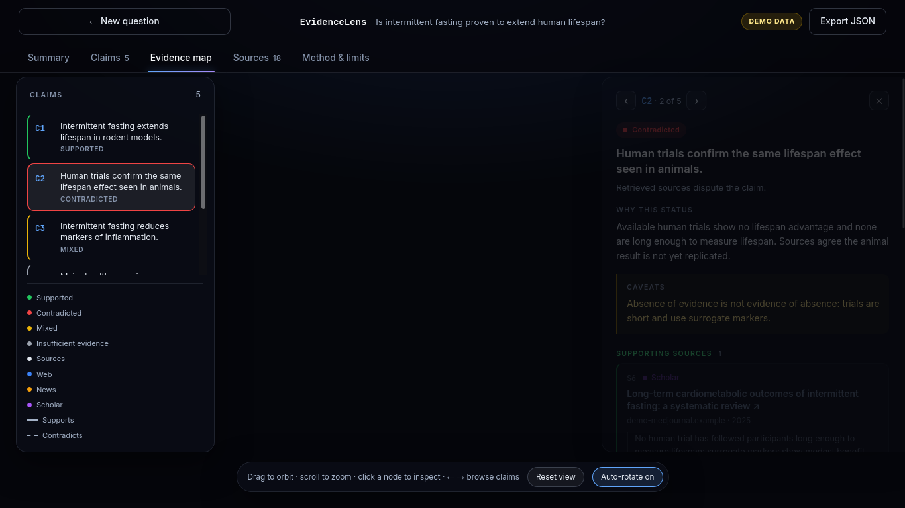
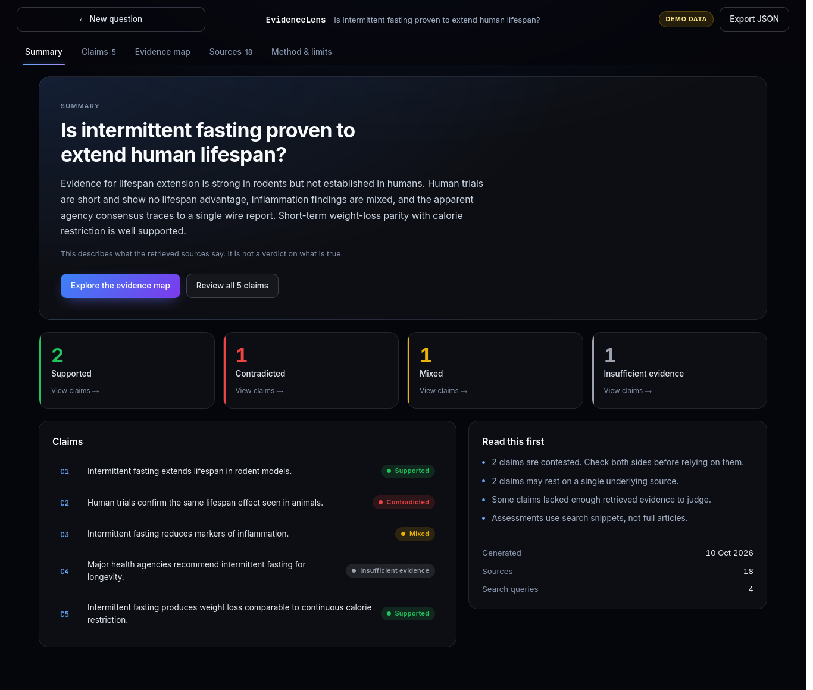

# EvidenceLens 🔍
> **An Evidence-First Research Agent with 3D Epistemic Cartography**  
> *Built for the SerpApi India Hackathon 2026 (AI Agents Track)*

[](LICENSE)
[](https://www.python.org/)
[](https://serpapi.com/)
[](https://docs.pmnd.rs/react-three-fiber)

EvidenceLens transforms disputed, scientific, and breaking inquiries into an **adversarial epistemic knowledge graph**. Instead of generating untraceable LLM summaries, EvidenceLens retrieves live evidence via SerpApi, extracts atomic claims, formulates targeted counter-evidence queries, and visualizes corroboration in an interactive **3D Observatory**.

---

## 📸 Screenshots & Visual Preview

| 3D Evidence Observatory | Evidence Matrix & Summary |
| :---: | :---: |
|  |  |
| *Glowing question core with orbiting claims (green=supported, red=contradicted), particle beams, and echo-chamber detection.* | *Structured Evidence Matrix with supporting/contradicting counts, domain ratios, and verified citations.* |

---

## ⚡ The Core Problem & Our Innovation

Current AI search systems and chatbot summarizers suffer from **epistemic overconfidence** and **information laundering**:
1. **The "Flat Summary" Fallacy:** They collapse complex disagreement into a single confident paragraph, erasing counter-evidence.
2. **The "Echo Chamber" Trap:** When 20 different blogs syndicate and copy 1 unverified wire dispatch, AI models falsely report "20 independent sources confirm this".
3. **Untraceable Citations:** Footnote links frequently don't match the claims they cite, or hallucinate citations altogether.

### What Makes EvidenceLens Different:
- **Multi-Engine SerpApi Retrieval:** Simultaneously searches **Google Web** (broad context), **Google News** (recency), and **Google Scholar** (peer-reviewed papers & clinical meta-analyses).
- **Adversarial by Design:** Generates targeted dialectical counter-queries (e.g. `"[claim] criticism OR methodology flaws OR refuted"`) to actively stress-test claims before labeling them.
- **Syndication Echo Detection & Fragility Analysis:** Evaluates token Jaccard snippet overlap across articles to detect duplicate wire dispatches. If an apparent consensus relies on a single root report, it is flagged as a **`⚠ Fragile Origin` (Single Point of Epistemic Failure)**.
- **Strict Pydantic Grounding:** Every claim status is strictly bound to valid Source IDs (`S1`, `S2`). Hallucinated citations are dropped via `repair_claim`, and claims without backing are downgraded automatically.
- **Budget-Capped:** Live search calls are strictly capped ($\le 7$ calls per inquiry) with automated disk caching.

---

## 🏗️ Quick Architecture Overview

```text
                      User Research Question
                                │
                                ▼
                       [ Query Planner ]
                (Decomposes into 2-4 focused queries)
                                │
                                ▼
                     [ SerpApi Multi-Engine ]
               ┌────────────────┼────────────────┐
               ▼                ▼                ▼
         Google Web        Google News     Google Scholar
        (Broad context)    (Breaking news) (Peer-reviewed)
               └────────────────┬────────────────┘
                                │
                                ▼
                      [ URL Normalizer ]
              (Canonicalizes, dedups, assigns S1..Sn)
                                │
                                ▼
                    [ Atomic Claim Extractor ]
               (Extracts claims citing valid Source IDs)
                                │
                                ▼
                   [ Adversarial Verification ]
         (Synthesizes counter-queries & fetches counter-evidence)
                                │
                                ▼
                    [ Epistemic Assessment ]
       (Shannon Entropy, Jaccard Echo Detection, Fragility SPOF)
                                │
                                ▼
              ┌─────────────────┴─────────────────┐
              ▼                                   ▼
      [ 3D Observatory ]                 [ Evidence Matrix ]
  (Three.js, beams, camera fly-in)     (Status, counts, source ledger)
```

---

## 🚀 Quickstart & Local Execution

### 1. Prerequisites
- Python 3.11+
- Node.js 18+ (for 3D web frontend)

### 2. Installation
```bash
# Clone the repository
git clone https://github.com/SarangRao20/SerpAPI_Hackathon.git
cd SerpAPI_Hackathon/evidencelens

# Python environment setup
python -m venv .venv
source .venv/bin/activate
pip install -r requirements.txt

# Web frontend setup
cd web
npm install
cd ..
```

### 3. Environment Setup
Copy `.env.example` to `.env`:
```bash
cp .env.example .env
```
Add your API keys:
```env
SERPAPI_API_KEY=your_serpapi_key_here
GEMINI_API_KEY=your_gemini_key_here
CACHE_DIR=cache
```

### 4. Running the System

Open **two terminal windows**:

**Terminal 1 — Backend SSE Server:**
```bash
cd evidencelens
.venv/bin/python server.py
# Running on http://127.0.0.1:8000
```

**Terminal 2 — 3D Web Frontend:**
```bash
cd evidencelens/web
npm run dev
# Running on http://localhost:5173
```

> **Instant Demo Mode (Zero Credentials Required):**  
> Navigate to: **[http://localhost:5173/?view=report&tab=map&sel=C2](http://localhost:5173/?view=report&tab=map&sel=C2)**  
> This boots directly into the 3D Observatory on longevity research, animating the glowing core, claim nodes, particle beams, and evidence matrix.

*(An alternate Streamlit frontend is also available via `.venv/bin/streamlit run app.py`)*

### 5. Running the Tests
```bash
pytest
```
All **20/20 unit and schema traceability tests** pass in `< 0.5s` using mocked adapters.

---

## 🌐 SerpApi Integration Breakdown

| SerpApi Engine / Tool | Role in EvidenceLens | Why This Data Matters |
| :--- | :--- | :--- |
| `google` | Broad factual context & primary entity search | Establishes the baseline consensus and public claims. |
| `google_news` | Real-time reporting & chronological tracking | Distinguishes current developments from stale claims. |
| `google_scholar` | Academic papers, clinical trials, meta-analyses | Grounds scientific and medical questions in peer-reviewed rigor rather than unverified blogs. |
| `serpapi` Python SDK | Low-latency Python client with custom disk caching | Enables resilient retries, backoff, and hard search call budgeting ($\le 7$). |

---

## 🤖 AI Tools & Models Used

- **Google Gemini 2.0 Flash (`google-genai`):** Used for structured JSON extraction across query planning, atomic claim extraction, counter-evidence query formulation, and executive synthesis.
- **Claude / Antigravity CLI:** Used as AI pair programming assistants for architectural planning, test-driven validation, and Three.js 3D Observatory choreography.

---

## 📄 License
This project is licensed under the [MIT License](LICENSE).
